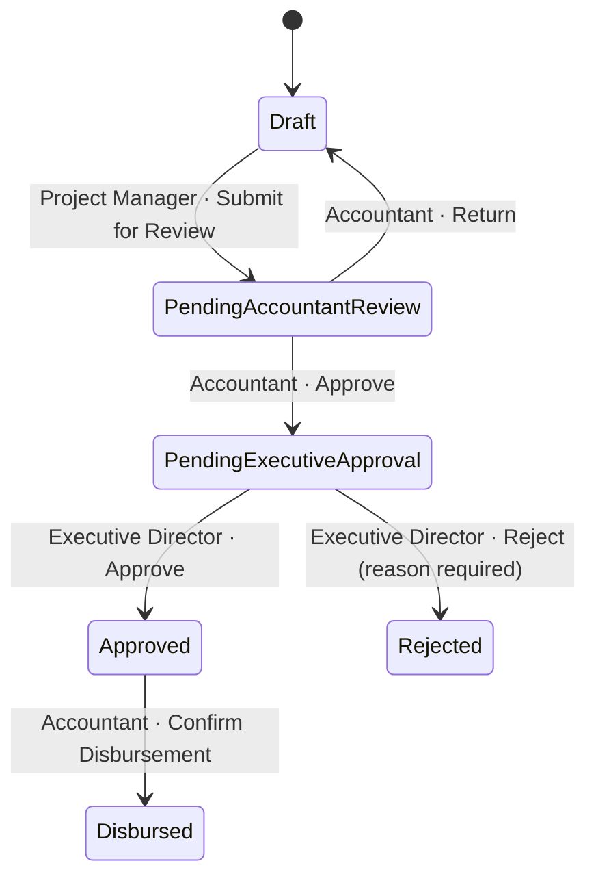

# Ataa Hub — real-time donations for nonprofits, built on Frappe

[](.github/workflows/ci.yml)


> **The problem.** Many associations receive their online-store donations as *monthly Excel files*, one per project, reconciled by hand. Project managers don't know their real balance, the executive director approves spending over WhatsApp, and the accountant matches bank, store and POS by hand.
>
> **The fix.** A custom Frappe app that receives donations **the moment they happen** from any channel, books each one to its project, updates balances instantly, and runs disbursements through an audited approval workflow.

Portfolio project. **Fake data only**, and payments use **Moyasar's test environment** only.

---

## What it does

| Channel | How it arrives | Status on arrival |
|---|---|---|
| Donation page (`/donate`) | Moyasar payment form → verified server-side with the secret key (callback **and** webhook) | `Pending` → `Paid` |
| Online store | `POST create_donation` (REST API, token auth) | `Paid` |
| POS terminal at an event | Same API, with `terminal_id`, `card_scheme`, `rrn` | `Paid` |
| Bank transfer | Accountant records it with the transfer proof, confirms after checking the statement | `Pending` → `Paid` |

Then, for every role:

- **Executive Director**: dashboard with KPIs, monthly trend, donations by channel, and the approval queue.
- **Project Manager**: sees **only their own projects** (row-level permissions), balances, and raises disbursement requests.
- **Accountant**: verifies bank transfers, reviews requests, confirms payouts, runs the **Moyasar reconciliation** report.

### Disbursement workflow



- The amount is re-checked against the balance at **every** forward step. Already-approved amounts are reserved, so two approvals can never spend the same riyal (the project row is locked with `SELECT … FOR UPDATE`).
- The project balance only goes down at **Disbursed**.
- Every transition is tracked (Track Changes) and notifies the next person in the bell icon.

---

## Quick start (Docker)

Needs [Docker Desktop](https://www.docker.com/products/docker-desktop/).

```bash
git clone <this-repo> ataa-hub
cd ataa-hub/docker
docker compose up
```

The first start takes **10–15 minutes** (it builds a Frappe v15 bench, creates the site and loads demo data). When the log shows `Ataa Hub is starting`, open:

| URL | What |
|---|---|
| http://localhost:8000/donate | Public donation page |
| http://localhost:8000/app | Staff desk (log in with an account below) |
| http://localhost:8000/api-docs | Interactive API documentation (Swagger UI) |

### Demo accounts (local only)

| Role | Email | Password |
|---|---|---|
| Executive Director | `ed@ataa.test` | `Ataa@Demo2026` |
| Project Manager | `pm@ataa.test` | `Ataa@Demo2026` |
| Project Manager (other projects) | `pm2@ataa.test` | `Ataa@Demo2026` |
| Donations Accountant | `accountant@ataa.test` | `Ataa@Demo2026` |
| System Manager | `Administrator` | `admin` |

API keys created by the demo seed (local only): store `demo_store_key:demo_store_secret`, POS `demo_pos_key:demo_pos_secret`, deactivated partner `demo_inactive_key:demo_inactive_secret`.

### Enable card payments (optional)

1. Create a free account at [moyasar.com](https://moyasar.com) and copy the **test** keys (`pk_test_…`, `sk_test_…`).
2. In the desk: **Moyasar Settings** → paste the keys (or put `moyasar_publishable_key` / `moyasar_secret_key` / `moyasar_webhook_secret` in `site_config.json`).
3. Pay on `/donate` with test card `4111 1111 1111 1111`.
4. To test the webhook locally, expose port 8000 (e.g. `cloudflared tunnel --url http://localhost:8000`) and register `https://<tunnel>/api/method/ataa_hub.payments.moyasar_webhook` in Moyasar with your webhook secret.

### Without Docker (existing bench)

```bash
bench get-app https://github.com/<you>/ataa_hub
bench --site <site> install-app ataa_hub
bench --site <site> execute ataa_hub.setup.demo.seed
```

---

## Integration API

Full contract: [API.md](API.md) · OpenAPI: [ataa_hub/public/openapi.yaml](ataa_hub/public/openapi.yaml) · live at `/api-docs`.

```bash
curl -X POST "http://localhost:8000/api/method/ataa_hub.api.v1.create_donation" \
  -H "Authorization: token demo_store_key:demo_store_secret" \
  -H "Content-Type: application/json" \
  -d '{"external_reference":"ORDER-100245","project_code":"SUQYA-01","amount":250,
       "paid_at":"2026-11-17T15:42:10+03:00","payment_reference":"pay_8f2c1a9b"}'
```

- **Idempotent**: `(API client, external_reference)` has a **UNIQUE index in the database**. Same request again → `200 duplicate:true`; same reference with another amount → `409`. A race between two identical requests is caught by the index, not just by application code.
- **Auth**: Frappe's native token auth, one machine user per client. Deactivating a client returns `403 CLIENT_INACTIVE` immediately.
- **Validation**: every invalid field is reported at once in `error.details`.
- **Audit**: the raw request body is stored on the donation (visible to System Manager / Accountant only through a permission level).

### Postman

Import [`postman/ataa_hub_v1.postman_collection.json`](postman/ataa_hub_v1.postman_collection.json) and the environment [`postman/ataa_hub_local.postman_environment.json`](postman/ataa_hub_local.postman_environment.json), then **Run collection**: 16 requests (online store, POS terminal, every error case), each with tests.

---

## Tests

```bash
docker compose exec frappe bash -lc "cd ~/frappe-bench && bench --site ataa.localhost run-tests --app ataa_hub"
```

| File | Covers |
|---|---|
| `tests/test_api_v1.py` | Idempotency, 401/403/404/409, every validation rule, POS fields, allow-lists, donor matching |
| `tests/test_api_http.py` | Through the real HTTP stack: valid key, wrong key → 401, missing key → 401 |
| `tests/test_business_rules.py` | Refund reverses balance, paid donations locked and undeletable, bank-transfer proof, full workflow, reserved approvals, rejection reason, row-level permissions |
| `tests/test_payments.py` | Callback + webhook record once, tampered amount rejected, webhook secret, reconciliation finds a payment missing in the platform |

CI runs lint + the full suite on every push ([.github/workflows/ci.yml](.github/workflows/ci.yml)).

---

## How it's built (Frappe conventions)

```
ataa_hub/
├── hooks.py                  # install hooks, row-level permission hooks, home page
├── api/v1.py                 # whitelisted REST endpoints (list_projects, create_donation, get_donation)
├── payments.py               # Moyasar: pending donation, server-side verification, webhook
├── services.py               # balances recomputed from source rows, donor matching, notifications
├── permissions.py            # Project Manager sees only own projects
├── setup/install.py          # roles + Workflow created idempotently on install/migrate
├── setup/demo.py             # fake demo data
├── ataa_hub/                 # module "Ataa Hub"
│   ├── doctype/              # 8 DocTypes (JSON + controller .py + form/list .js)
│   ├── report/               # 3 Script Reports
│   ├── number_card/          # 9 Number Cards
│   ├── dashboard_chart/      # 3 Dashboard Charts
│   └── workspace/            # 3 role dashboards
├── www/donate/               # public pages (Jinja + Python context)
├── public/                   # CSS, JS, images, openapi.yaml
├── translations/ar.csv       # Arabic UI
└── tests/
```

Design decisions worth noting:

- **Balances are recomputed, never incremented.** `SUM()` over paid donations and disbursed requests, so retries, refunds and late webhooks can't drift the numbers.
- **Built-in Frappe first**: Workflow, Track Changes, Number Cards, Dashboard Charts, Workspaces, Script Reports, permission levels, token auth. Custom code only where the PRD needs a rule Frappe doesn't have.
- **Never trust the browser**: the callback page ignores its query string and fetches the payment from Moyasar with the secret key, comparing status, amount (halalas) and donation id.

Product requirements: [PRD.md](PRD.md) (Arabic).
