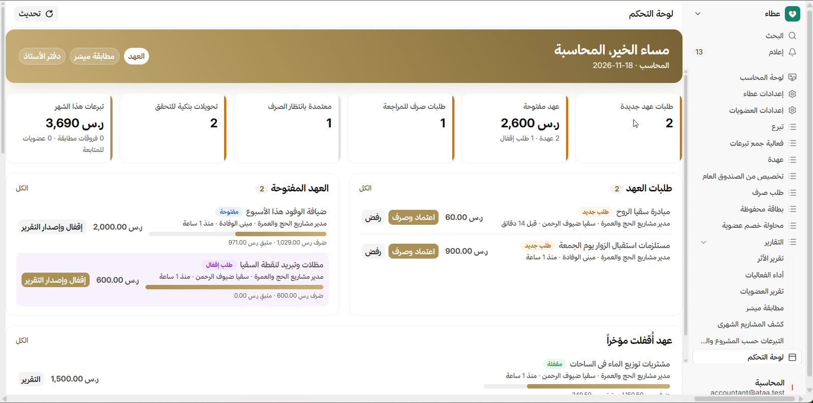
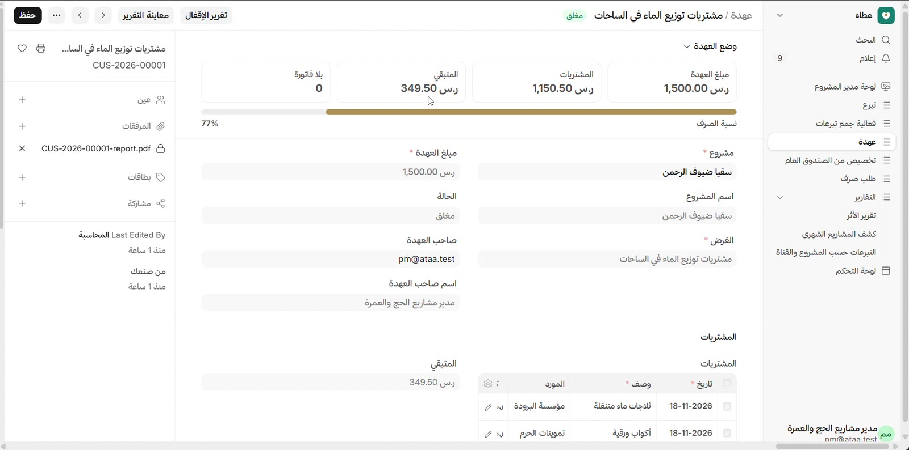
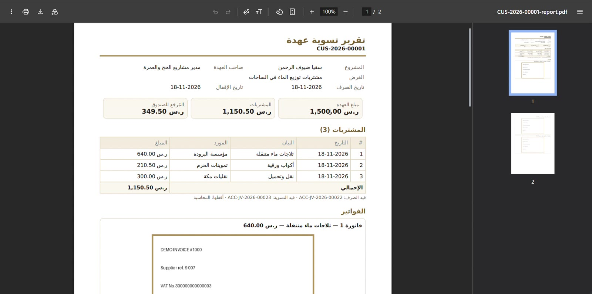
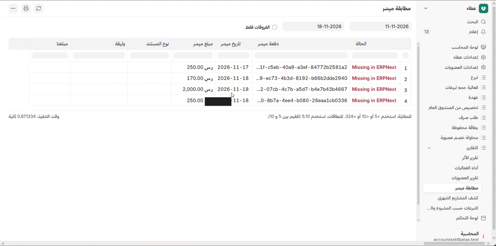
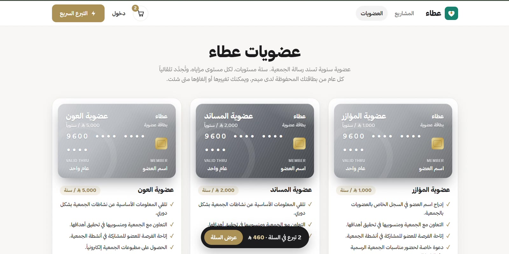
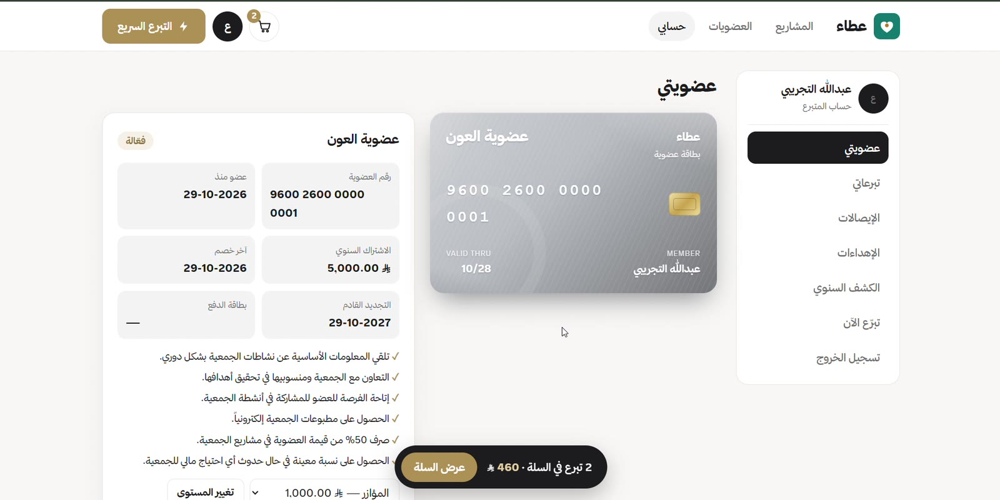
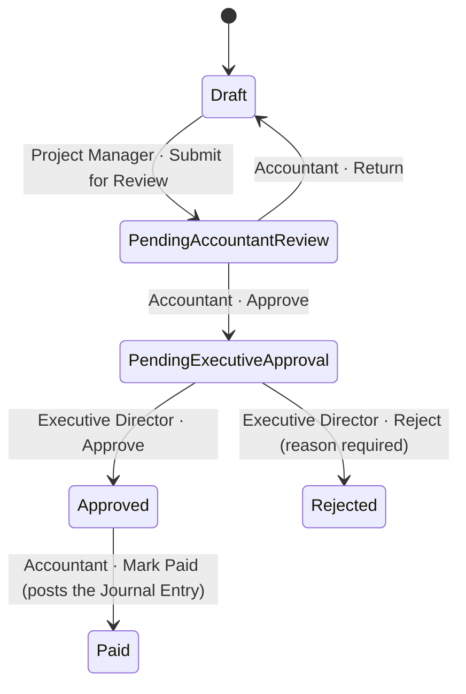

# Ataa Hub — donations, memberships and governed spending on ERPNext

[](.github/workflows/ci.yml)


> **The problem.** Many Saudi associations receive their online-store donations as *monthly Excel files*, reconciled by hand. Project managers don't know their real balance, spending is approved over WhatsApp, and members forget to renew.
>
> **The fix.** A custom Frappe app on top of **ERPNext v16** that books every donation to its project in the **General Ledger** the moment it arrives (website, store, POS, bank), runs spending and staff custody through audited approval workflows, and renews memberships with saved cards. **The GL is the single source of truth**: every balance on every screen is read from it.

Portfolio project. **Fake data only.** Card payments use **Moyasar's test environment** only. ERPNext and Frappe core are never modified.

## See it

**▶ [Watch the walkthrough (about a minute)](docs/media/ataa-journey.mp4)**: a custody advance from request to closing report, an approval by the executive director, then the donor on desktop and phone.

| Project manager | Accountant | Executive director |
|---|---|---|
|  |  |  |
| **Custody with its purchases** | **Custody closing report (PDF)** | **Moyasar reconciliation** |
|  |  |  |
| **Memberships** | **Checkout (card or bank transfer)** | **Donor account** |
|  |  |  |

## What it does

| Area | How |
|---|---|
| **Donations** | `/donate` with Moyasar, verified server-side (callback **and** webhook). Each donation posts one Journal Entry with the project on both lines |
| **Stores and POS** | REST API with token auth. A **unique index** on `(client, external_reference)` makes retries safe: a replay returns `200 duplicate`, a changed amount `409`. POS terminals are accepted only inside their event's time window |
| **Restricted funds** | A project can never spend more than its GL balance minus approved-but-unpaid requests and open custody. Checked at submit, at each approval and at payment, under a row lock |
| **Disbursements** | Project Manager → Accountant → Executive Director → Accountant pays. Every transition is versioned (user + time) |
| **Staff custody (عهدة)** | Request → pay → purchases with invoices → close. Closing books the spend on the project, returns the rest to the bank and attaches a PDF report |
| **Memberships** | Six annual tiers on native **Subscription → Sales Invoice → Payment Entry**. Cards tokenised by Moyasar (no card data stored). Daily charging with retries at +3 and +7 days, then suspension |
| **Donor portal** | `/my-giving`: donations, PDF receipts and statement, gifts, membership card. A donor only sees their own rows |
| **Reconciliation** | Daily job compares Moyasar with the GL and records payments whose callback and webhook were both lost |
| **Reports** | Six Script Reports and three role dashboards (details in [docs/SETUP.md](docs/SETUP.md#reports)) |
| **ZATCA** | Arabic simplified tax invoice with QR for memberships; signing via [`ksa_compliance`](https://github.com/lavaloon-eg/ksa_compliance), tested on the sandbox |

### Disbursement workflow



### Money flow (all in the General Ledger)

| Event | Debit | Credit |
|---|---|---|
| Donation | Moyasar / Bank / Store / POS clearing | Restricted or Unrestricted Donations Income |
| Membership invoice → payment | Debtors → Moyasar Clearing | Membership Income → Debtors |
| Fund Allocation | Fund Transfers Out (GENERAL) | Fund Transfers In (restricted project) |
| Disbursement paid | Project Program Expenses | Main Bank Account |
| Custody paid → closed | Staff Custody → Program Expenses + Bank (cash returned) | Main Bank Account → Staff Custody |

## How it's built

- **Reuse ERPNext first.** Project, Customer, Journal Entry, Subscription, Sales Invoice, Payment Entry, Workflow, Number Card, Workspace, Script Report. New DocTypes only where ERPNext has no concept (Donation, Disbursement Request, Fund Allocation, Custody, Fundraising Event, API Client, Donor Payment Method…).
- **No core changes.** Everything goes through Frappe hooks: `doc_events`, `scheduler_events`, `permission_query_conditions`, `has_permission`, `fixtures` and `extend_bootinfo`. The last one makes staff see one product: the ERPNext tile leaves their apps screen and the Ataa sidebar becomes their home, while System Managers keep the full desk.
- **Balances are never stored.** They are summed from GL Entry, so retries, cancellations and late webhooks can't drift a number.
- **Never trust the browser.** The callback fetches the payment from Moyasar with the secret key and compares status, amount and donation id.
- **Money moves under a row lock.** Spending checks and membership charges lock the row (`SELECT … FOR UPDATE`), and a charge attempt is committed *before* calling Moyasar, so a crash can never charge twice.

```
ataa_hub/
├── hooks.py            # all integration points with Frappe and ERPNext
├── accounting.py       # project balance and available amount: SUM over GL Entry
├── payments.py         # Moyasar verification and webhook
├── memberships.py      # sign-up, daily charging, dunning, self-service
├── reconciliation.py   # daily Moyasar ↔ GL reconciliation
├── permissions.py      # row-level rules for project managers and donors
├── boot.py             # one-product desk for staff
├── api/v1.py           # REST endpoints for stores and POS
├── overrides/          # Journal Entry guard (donation income needs a project)
├── setup/              # install, setup wizard, accounts, workflows, demo seed
├── ataa_hub/doctype/   # 17 DocTypes
├── ataa_hub/report/    # 6 Script Reports
├── www/                # donate, membership, my_giving, event, gift, verify, api-docs
└── tests/              # 185 integration tests
```

## Integration API

Contract: [API.md](API.md) · OpenAPI: [openapi.yaml](ataa_hub/public/openapi.yaml) · live at `/api-docs` · Postman collection in [`postman/`](postman/) (30 requests with tests).

```bash
curl -X POST "http://localhost:8000/api/method/ataa_hub.api.v1.create_donation" \
  -H "Authorization: token demo_store_key:demo_store_secret" \
  -H "Content-Type: application/json" \
  -d '{"external_reference":"ORDER-100245","project_code":"SUQYA-01","amount":250,
       "paid_at":"2026-11-17T15:42:10+03:00","payment_reference":"pay_8f2c1a9b"}'
```

## Tests

**185 integration tests** run against a real ERPNext site on every push ([CI](.github/workflows/ci.yml)). Moyasar is replaced by a fake in tests, so no network is needed. Acceptance criteria are mapped to tests in [docs/ACCEPTANCE.md](docs/ACCEPTANCE.md).

| Area | Tests | Covers |
|---|---|---|
| API | 37 | Idempotency, 401/403/404/409, event windows, through the real HTTP stack |
| Donations and accounting | 31 | One JE per donation, cancel reverses, balances from the GL only |
| Spending and custody | 31 | Overspend blocked at every step, one role per step, custody close with GL lines |
| Memberships | 21 | Daily charging, never charged twice, dunning, change tier or card |
| Portal, reports, payments, events, setup | 65 | Own data only, reports with known numbers, tampered amounts rejected |

## Run it

```bash
git clone https://github.com/hiiffaa1243-tech/ataa-hub.git
cd ataa-hub/docker
docker compose up      # first start ~25 minutes, then http://localhost:8000
```

Or open it in [GitHub Codespaces](https://codespaces.new/hiiffaa1243-tech/ataa-hub) with no install. Demo accounts, Moyasar test keys and the ZATCA sandbox are in **[docs/SETUP.md](docs/SETUP.md)**.

Product requirements: [PRD.md](PRD.md) · build plan: [docs/BUILD_PLAN.md](docs/BUILD_PLAN.md) · Arabic walkthrough: [docs/شرح-المشروع.md](docs/شرح-المشروع.md).
