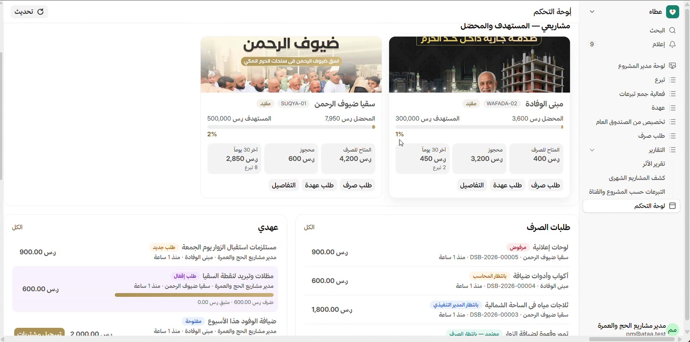
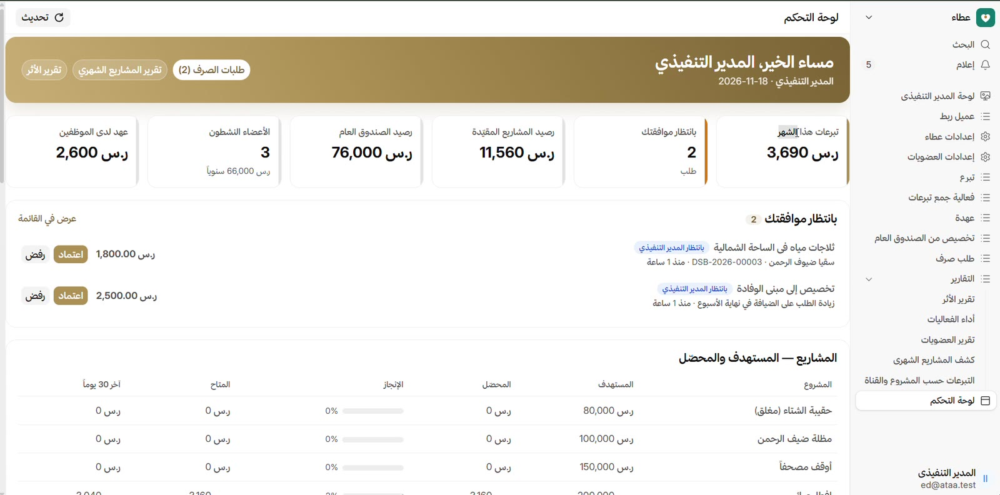
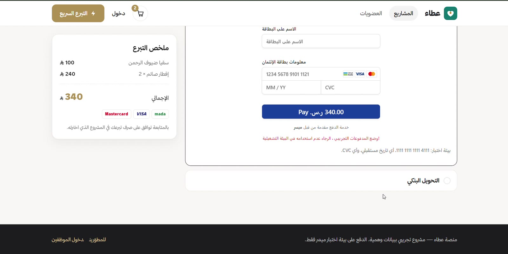
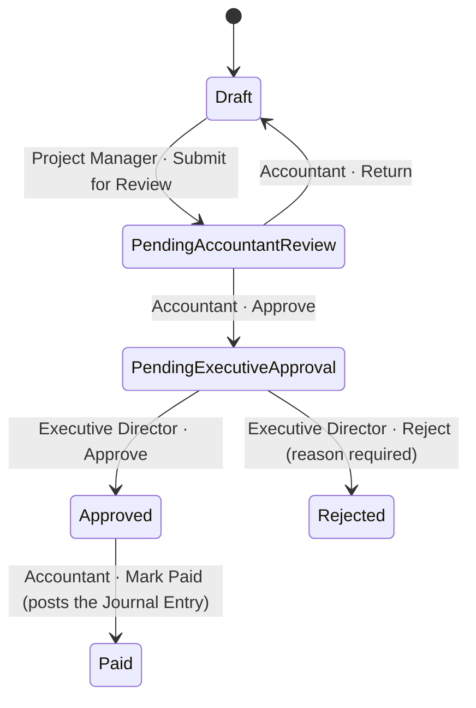
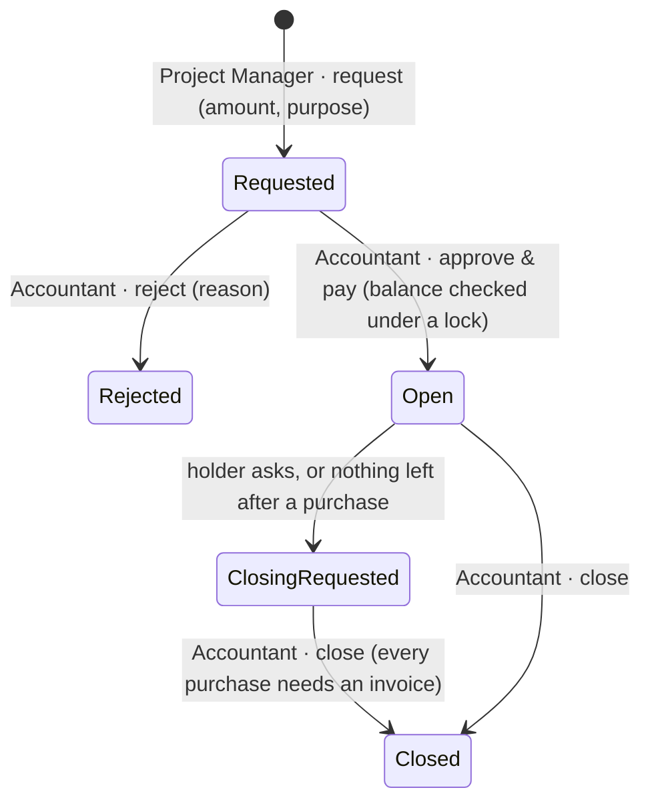

# Ataa Hub — donations, memberships and governed spending on ERPNext

[](.github/workflows/ci.yml)


> **The problem.** Many Saudi associations receive their online-store donations as *monthly Excel files*, one per project, reconciled by hand. Project managers don't know their real balance, the executive director approves spending over WhatsApp, members pay by bank transfer and forget, and the accountant matches bank, store and POS by hand.
>
> **The fix.** A custom Frappe app on top of **ERPNext v16** that receives every donation the moment it happens (website, store, POS, bank), books it to its project in the **General Ledger**, bills annual memberships with saved cards, runs spending through an audited approval workflow, and gives donors a self-service portal. **The GL is the single source of truth**: every balance on every screen is read from it.

Portfolio project. **Fake data only.** Card payments use **Moyasar's test environment** only. ERPNext and Frappe core are never modified.

---

## See it

**▶ [Watch the walkthrough (about a minute)](docs/media/ataa-journey.mp4).** A custody advance from request to closing report: the project manager asks, the accountant pays, the PM logs purchases with invoices, the accountant closes it and the PDF report comes out, the executive director approves spending. Then the donor on desktop and on a phone.

| Project manager | Accountant | Executive director |
|---|---|---|
|  |  |  |
| **Custody with its purchases** | **Custody closing report (PDF)** | **Moyasar reconciliation** |
|  |  |  |
| **Memberships** | **Checkout (card or bank transfer)** | **Donor account** |
|  |  |  |

---

## What it does

| Area | How |
|---|---|
| **Donation page** `/donate` | Moyasar payment form → payment verified server-side with the secret key (callback **and** webhook) → Donation submitted → Journal Entry with the project on both lines |
| **Stores and partners** | REST API with token auth. `(client, external_reference)` is a **unique index** in the database: replays return `200 duplicate`, a changed amount returns `409` |
| **POS at events** | Same API with `terminal_id`, `card_scheme`, `rrn`, `event_code`. Each terminal is registered to an event and only accepted inside its time window |
| **Live event screen** `/event/<code>` | Big-screen page for a booth: total, progress, last hour, per project, per terminal. No donor names. Guests can't use socket.io in v16, so it polls a 30-second cached feed that is cleared on every donation |
| **Bank transfers** | Accountant records the transfer with its proof and submits after checking the statement |
| **Memberships** | Six annual tiers (Muazir 1,000 → Daem 100,000 SAR) on native **Subscription (yearly) → Sales Invoice → Payment Entry**, each with its benefits and a unique membership number shown on a bank-style card. The card is tokenised by Moyasar (we only keep the token in a Password field, never card data). A daily job charges due invoices, retries at +3 and +7 days, then suspends. Members can change tier, update their card or cancel from the portal |
| **Restricted funds** | A restricted project can never spend more than its GL balance minus approved-but-unpaid requests. Checked at submit, at each approval and at payment, with the project row locked. Unrestricted money reaches a restricted project only through an approved **Fund Allocation** |
| **Disbursement workflow** | Project Manager → Accountant → Executive Director → Accountant pays. Every transition is versioned (user + time). Payment posts one Journal Entry |
| **Donor portal** `/my-giving` | Donations, receipts (PDF), gifts, annual statement (PDF), membership card, change card. A donor only ever sees their own rows (permission query conditions + `has_permission`) |
| **Gifts and receipts** | Gift link `/gift/<token>` (amount hidden unless the donor opts in). Receipt QR → `/verify/<token>` confirms number, date, amount and project, never the donor |
| **Reports and workspaces** | Six Script Reports and three role workspaces with 13 Number Cards (see below) |
| **Moyasar reconciliation** | Daily job compares Moyasar's payments with the GL, **heals** website payments whose callback and webhook were both lost, and reports the rest |
| **ZATCA** | Arabic simplified tax invoice for memberships with a QR. Signing and reporting are done by the separate [`ksa_compliance`](https://github.com/lavaloon-eg/ksa_compliance) app; when it has processed an invoice we print its Phase-2 QR, otherwise a Phase-1 TLV QR |

### Disbursement workflow



### Staff custody (عهدة)



The holder logs each purchase (date, description, supplier, amount, invoice) on the custody itself; spent and remaining add up as they type, and purchases can never exceed the custody. While a custody is open its full amount is held back from the project's available balance, like an approved disbursement. Closing books the purchases on the project, returns the cash left to the bank, and attaches a PDF report with every purchase and its invoice image (`Ataa Custody Report`).

### Money flow (all in the General Ledger)

| Event | Debit | Credit | Project on |
|---|---|---|---|
| Donation (website) | Moyasar Clearing | Restricted / Unrestricted Donations Income | both lines |
| Donation (bank / store / POS) | Main Bank Account / Online Store Clearing / mada POS Clearing | Restricted / Unrestricted Donations Income | both lines |
| Membership invoice | Debtors | Membership Income (+ VAT if configured) | GENERAL |
| Membership payment | Moyasar Clearing | Debtors | GENERAL |
| Fund Allocation | Fund Transfers Out (GENERAL) | Fund Transfers In (restricted project) | each line |
| Disbursement paid | Project Program Expenses | Main Bank Account | both lines |
| Custody paid | Staff Custody | Main Bank Account | both lines |
| Custody closed | Project Program Expenses (spent) + Main Bank Account (cash returned) | Staff Custody | every line |

---

## Try it in the browser (no install)

[](https://codespaces.new/hiiffaa1243-tech/ataa-hub)

1. Click the button (uses your own GitHub account's free Codespaces hours; pick the 4-core machine).
2. When the editor opens, run in its terminal:
   ```bash
   cd docker && docker compose up
   ```
3. After about 25 minutes the log shows `Ataa Hub is starting`. Open the **Ports** tab, then port **8000** in the browser, and sign in with an account from the table below.
4. Stop the Codespace when you are done, so it does not use your hours.

## Quick start (Docker)

Needs [Docker Desktop](https://www.docker.com/products/docker-desktop/).

```bash
git clone https://github.com/hiiffaa1243-tech/ataa-hub.git
cd ataa-hub/docker
docker compose up
```

The first start takes **about 25 minutes**: it installs Python 3.14 and Node 24, builds an ERPNext v16 bench, creates the site, finishes the setup wizard headless for a fake association (**جمعية عطاء التجريبية**) and loads the demo data. When the log shows `Ataa Hub is starting`, open:

| URL | What |
|---|---|
| http://localhost:8000/login | Staff sign-in (accounts below); staff land on their dashboard `/desk/ataa-home` |
| http://localhost:8000/donate | Public donation page |
| http://localhost:8000/event/CLOCKTOWER-2026 | Live event screen (Clock Tower booth) |
| http://localhost:8000/membership | Membership sign-up |
| http://localhost:8000/my-giving | Donor portal |
| http://localhost:8000/api-docs | Interactive API documentation (Swagger UI) |

`DEMO_DATA=0 docker compose up` starts an empty association instead.

### Demo accounts (local only, fake people)

| Role | Email | Password | Start at |
|---|---|---|---|
| Executive Director | `ed@ataa.test` | `Ataa@Demo2026` | Dashboard: KPIs and approvals |
| Donations Accountant | `accountant@ataa.test` | `Ataa@Demo2026` | Dashboard: custody, payments, bank transfers |
| Project Manager (Suqya + Wafada) | `pm@ataa.test` | `Ataa@Demo2026` | Dashboard: own projects, requests, custody |
| Project Manager (Iftar) | `pm2@ataa.test` | `Ataa@Demo2026` | Dashboard: own projects, requests, custody |
| Donor (Aoun member) | `donor@ataa.test` | `Ataa@Demo2026` | `/my-giving` |
| System Manager | `Administrator` | `admin` | |

API keys created by the demo seed (local only): store `demo_store_key:demo_store_secret`, POS `demo_pos_key:demo_pos_secret`, deactivated partner `demo_inactive_key:demo_inactive_secret`.

### What the demo seed contains

`bench --site <site> execute ataa_hub.setup.demo.seed` (local sites only, safe to run again):

- 6 restricted projects (5 open with photos, 1 completed) + the GENERAL fund, an API client per channel, the event **CLOCKTOWER-2026** with terminals T01 and T02.
- 22 donations over three months: confirmed and waiting bank transfers, store orders, 7 POS donations at the booth in the last hours, 2 gifts.
- One disbursement request in **each** workflow state (Draft, Pending Accountant Review, Pending Executive Approval, Approved, Rejected, Paid) and a Fund Allocation waiting for the Executive Director.
- 4 custody advances: one closed with its PDF report, one open with purchases, one fully spent and waiting for the accountant to close it, one new request.
- 4 members (Aoun, Adeed, Muazir, and a Kareem member in **Payment Pending** after a declined charge).
- 3 company bank accounts with fake IBANs for the checkout's bank-transfer option.

`bench --site <site> execute ataa_hub.setup.demo.summary` prints balances, card values and the audit trail of the paid request. CI runs the seed twice on a clean site on every push.

### Card payments (optional)

1. Create a free account at [moyasar.com](https://moyasar.com) and copy the **test** keys (`pk_test_…`, `sk_test_…`).
2. Put them in **Moyasar Settings** in the desk, or as `MOYASAR_PUBLISHABLE_KEY` / `MOYASAR_SECRET_KEY` in the environment (Codespaces secrets). Never in the repo.
3. Pay on `/donate` or `/membership` with test card `4111 1111 1111 1111`.
4. To receive webhooks locally, expose port 8000 (e.g. `cloudflared tunnel --url http://localhost:8000`) and register `https://<tunnel>/api/method/ataa_hub.payments.moyasar_webhook` with your webhook secret.

### ZATCA sandbox (optional)

```bash
bench --site <site> install-app ksa_compliance   # after: bench get-app https://github.com/lavaloon-eg/ksa_compliance
bench --site <site> execute ataa_hub.zatca.setup_sandbox_demo
```

`setup_sandbox_demo` sets ZATCA's published sandbox VAT number on the company and a **15 % VAT included** template (with a Standard-rate tax category) for membership invoices, so a 50 SAR member still pays 50 SAR. Then fill **ZATCA Business Settings** (Fatoora server *Sandbox*), set up the CLI from that screen and onboard with the sandbox OTP. In our run the sandbox returned **Accepted with warnings** for a membership invoice; the only warning (BR-KSA-08) asks for the seller's commercial registration number. The VAT treatment of a real association is a question for its tax advisor (PRD Q1), so nothing tax-related runs on install.

---

## Reports and workspaces

| Report | For | Shows |
|---|---|---|
| Donations by Project and Channel | ED, Accountant | Count, total and average per project × channel, with a chart |
| Monthly Project Statement | ED, Accountant, PM | Opening, donations, memberships, transfers in/out, expenses, closing per project, all from the GL. Closing equals `get_project_balance` |
| Moyasar Reconciliation | Accountant | Every Moyasar payment against the GL: Matched, Missing in ERPNext, Missing at Moyasar, Amount Mismatch, Cancelled in ERPNext |
| Membership Report | ED | Per tier: active, payment pending, suspended, new, cancelled, annual revenue (ARR), churn |
| Impact Report | ED, PM | Impact units (meals, pilgrims served…) per project and month, frozen at the time of giving |
| Event Performance | ED | One event by hour, terminal or card scheme |

**Staff dashboard** (`/desk/ataa-home`, where staff land after login): one desk Page with a view per role, built from our own whitelisted methods (`staff_dashboard.py`) and standard Frappe UI. No ERPNext code is changed.

**One product for staff.** Staff see عطاء, not ERPNext beside it: the `extend_bootinfo` hook (`boot.py`) takes the ERPNext tile off their apps screen and makes our sidebar (`sidebar/ataa_hub`, filtered by permission, empty headings dropped) their desk home, and `/desk` opens the dashboard. ERPNext pages they need (a Project, a Journal Entry, the General Ledger) still open from our sidebar. System Managers keep the full ERPNext desk.

| Role | Sees | Can do from the page |
|---|---|---|
| Project Manager | Own projects as cards: target vs collected, available, reserved, last 30 days; own requests and custody; latest donations | Add a project (dialog with donation page fields and preset amounts), request a disbursement (sent straight to the accountant), request a custody, open a custody to log purchases |
| Executive Director | Donations this month, restricted / general balances, members, cash with staff; everything waiting for approval; all projects | Approve or reject requests and allocations (reason required) |
| Accountant | New custody requests, open custody with progress, close requests highlighted, requests to review and to pay, bank transfers to verify | Approve & pay or reject custody, close custody and issue the report, approve / return / mark paid |

Workspaces: **Ataa Executive**, **Ataa Project Manager**, **Ataa Accountant** stay as the menu (reports, lists). Each Number Card calls a whitelisted method that checks the role first.

---

## Integration API

Full contract: [API.md](API.md) · OpenAPI: [ataa_hub/public/openapi.yaml](ataa_hub/public/openapi.yaml) · live at `/api-docs`.

```bash
curl -X POST "http://localhost:8000/api/method/ataa_hub.api.v1.create_donation" \
  -H "Authorization: token demo_store_key:demo_store_secret" \
  -H "Content-Type: application/json" \
  -d '{"external_reference":"ORDER-100245","project_code":"SUQYA-01","amount":250,
       "paid_at":"2026-11-17T15:42:10+03:00","payment_reference":"pay_8f2c1a9b"}'
```

Postman: import [`postman/ataa_hub_v2.postman_collection.json`](postman/ataa_hub_v2.postman_collection.json) and [`postman/ataa_hub_local.postman_environment.json`](postman/ataa_hub_local.postman_environment.json), then **Run collection** (30 requests with tests: store, POS at the event, every error case).

---

## Tests

```bash
docker compose exec frappe bash -lc "cd ~/frappe-bench && bench --site ataa.localhost set-config allow_tests true && bench --site ataa.localhost run-tests --app ataa_hub"
```

185 integration tests, green on a fresh site and in CI. Moyasar is reached only through `ataa_hub.moyasar.get_client()`, which tests replace with a fake, so no network is needed.

| File | Tests | Covers |
|---|---|---|
| `test_setup.py` | 11 | Accounts, modes of payment, roles, custom fields, tiers → items and plans, idempotent setup |
| `test_donation.py` | 23 | One JE per donation with the project on both lines, cancel reverses, proof required, impact frozen, row-level rules |
| `test_accounting.py` | 8 | Balances read from the GL only |
| `test_api.py` / `test_api_http.py` | 32 / 5 | Idempotency, 401/403/404/409, event window and terminals, gifts, through the real HTTP stack |
| `test_payments.py` | 7 | Callback and webhook record once, tampered amount never recorded, webhook secret |
| `test_spending.py` | 18 | Overspend blocked at every step, reserved approvals, one role per step, fund allocation, audit tracking |
| `test_memberships.py` | 21 | Sign-up, daily charging, never charged twice, dunning, stale attempts, change tier/card, cancel, honorary |
| `test_portal.py` | 15 | Own data only, PDFs, verify and gift pages, membership card |
| `test_events.py` | 8 | Feed totals, no donor data, cache cleared on submit, guest endpoint |
| `test_reports.py` | 14 | Every report with known numbers, reconciliation and healing, cards and their permissions, impact email, ZATCA QR and invoice |
| `test_boot.py` | 3 | Staff see one app and a clean sidebar, Administrator keeps the full desk, Executive Director can run the Membership Report |
| `test_cart.py` | 7 | Cart drafts, one Moyasar payment for several donations, bank transfer with receipt, catalog hides targets |
| `test_custody.py` | 13 | Custody pay / purchases / auto close request / close with GL lines and PDF report, limits, roles, row-level access; dashboard data per role and its dialogs |

The PRD acceptance criteria are mapped to these tests in [docs/ACCEPTANCE.md](docs/ACCEPTANCE.md).

---

## How it's built

```
ataa_hub/
├── hooks.py              # doc_events, scheduler, permission hooks, routes, fixtures, jinja
├── accounting.py         # get_project_balance / get_available: SUM over GL Entry
├── payments.py           # Moyasar: pending donation, server-side verification, webhook
├── moyasar.py            # the only HTTP client for Moyasar (patched in tests)
├── memberships.py        # sign-up, daily charging, dunning, status, self-service
├── reconciliation.py     # daily Moyasar ↔ GL reconciliation with healing
├── events.py, public.py  # live event feed, gift and verify pages
├── dashboards.py         # Number Card methods (role-guarded)
├── impact.py, zatca.py   # monthly impact email, invoice QR and sandbox setup
├── permissions.py        # row-level rules for PMs and portal donors
├── api/v1.py             # REST endpoints for stores and POS
├── portal/               # whitelisted methods for /my-giving and /membership
├── overrides/            # Journal Entry guard (donation income needs a project)
├── setup/                # install, setup wizard, company/accounts, workflows, demo seed
├── ataa_hub/doctype/     # 15 DocTypes (Donation, Disbursement Request, Fund Allocation, …)
├── ataa_hub/report/      # 6 Script Reports
├── ataa_hub/workspace/   # 3 role workspaces
├── fixtures/             # custom fields, roles, number cards
├── www/                  # donate, membership, my_giving, event, gift, verify, api-docs
├── templates/            # emails, print templates
└── tests/                # 162 integration tests
```

Design decisions worth noting:

- **Reuse ERPNext first.** Project, Customer, Journal Entry, Subscription, Sales Invoice, Payment Entry, Workflow, Version, Number Card, Workspace, Script Report. New DocTypes only where ERPNext has no concept (Donation, Disbursement Request, Fund Allocation, Fundraising Event, API Client, Donor Payment Method, Membership Charge Attempt).
- **Balances are never stored.** They are summed from GL Entry, so retries, cancellations and late webhooks can't drift a number.
- **Never trust the browser.** The callback page ignores its query string and fetches the payment from Moyasar with the secret key, comparing status, amount in halalas and the donation id.
- **Money moves under a row lock.** Spending checks and membership charges lock the project or invoice row (`SELECT … FOR UPDATE`), and a charge attempt is committed *before* calling Moyasar, so a crash can never charge twice.

Product requirements: [PRD.md](PRD.md) · build plan: [docs/BUILD_PLAN.md](docs/BUILD_PLAN.md) · Arabic walkthrough: [docs/شرح-المشروع.md](docs/شرح-المشروع.md).
